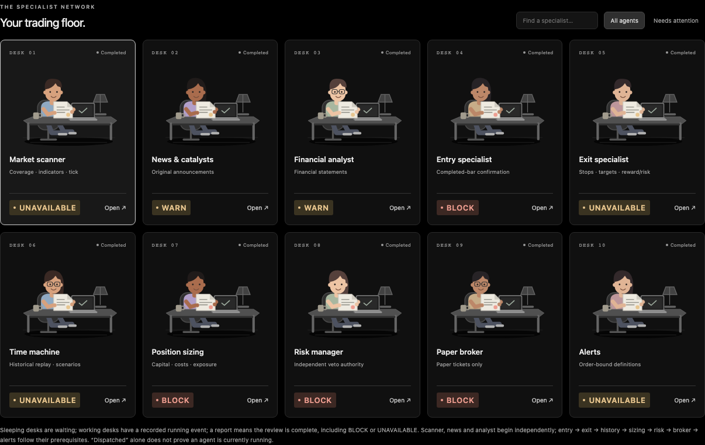
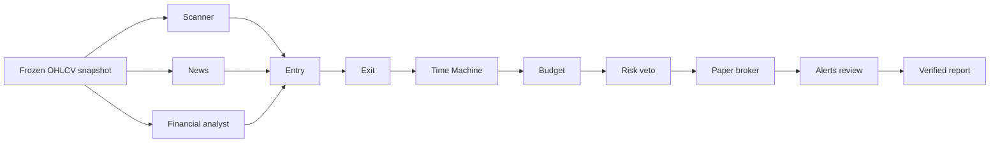

# Indian Trading Agents for Codex

A Codex adaptation of the original **day-trader-skill** for NSE/BSE equities: modular trading tools, INR risk calculations, local paper records, and optional independent specialists with a React dashboard.

Codex follows the skills and runs Python tools. The original-style workflow passes files from scanning through entry, exit, simulation, sizing, risk and a paper ticket. The separate independent-review mode freezes numerical evidence and records actual specialist decisions for the dashboard.

**Status: experimental research software. Live order execution is disabled. No profitability, real-time-feed or production-readiness claim is made.**

> **Data permissions:** the MIT software license does not license exchange data, news or filings. The repository contains captured third-party regression fixtures whose redistribution rights have not been established. Review [release readiness](docs/RELEASE.md) before publishing a copy. NSE website terms restrict automated collection and simulation/data reuse; public accessibility does not establish permission.

## What it does

- Cash-equity universe discovery, multi-symbol daily setup scans and opening-range scans.
- Completed-bar ORB/price-level entries and bounded foreground polling on supported intervals.
- Approximate candle VWAP, Wilder RSI14, EMA9/EMA21 and relative volume.
- Midpoint, range-low, ATR, percentage and explicit-price stops with tick-rounded targets.
- Cash-funded whole-share sizing in INR, including estimated charges and slippage.
- Next-bar historical replay, chronological holdout research and cost stress scenarios.
- Seeded scenario resampling when at least 20 complete prior sessions are available.
- Ten independent Codex reviewers, shared evidence files and a final risk veto.
- A black-themed React dashboard with animated, clickable specialist desks.
- Snapshot archives, offline numerical replay, data-health checks and bounded scheduled checks.
- Persistent once-only price/time alerts and a transactional SQLite local paper ledger.
- Dated RSS news, sourced financial-export analysis and optional Indian public-insider exports.

It does not submit orders, reconcile broker accounts, guarantee fills or run an implicit background notification service. The Indian source integrations and broker boundary differ from upstream; see the [feature map and complete workflow](docs/WORKFLOW.md).



*Agent desks reflect recorded states. A completed report can still veto a setup.*

## Requirements

| Component | Requirement |
| --- | --- |
| Analysis CLI | Python 3.8+; standard library only |
| Dashboard build | Node.js 20.19+ or 22.12+ and npm |
| Independent agent team | Codex host exposing native subagent delegation |
| Online data | Provider access and permission for the intended use |

Run commands from the repository root. A virtual environment is optional; the Python runtime has no external package dependencies. Node is needed to build the dashboard, but not to serve an already built frontend.

## 1. Run the original-style workflow

The active tool names now match upstream: `scan.py`, `entry.py`, `exit.py`, `timemachine.py`, `size.py`, `check.py`, `ticket.py`, `alerts.py`, `news.py`, `facts.py` and `ptr.py`. All eleven preserved US originals remain unchanged in `legacy/`; Indian adapters reuse their working rules rather than invoking US market commands.

Follow the [complete offline command example](docs/WORKFLOW.md#run-the-complete-offline-paper-example). It produces a fictional `DEMO.NS` midpoint-stop plan at ₹102.30 / ₹99.95 / ₹107.00, sizes **195 shares**, checks estimated loss including costs of **₹498.88**, and shows `READY_PAPER_TICKET` without approval or execution. It also persists stop, target and flatten alerts. The short fixture correctly reports insufficient simulation history.

Use `$trader-team` in Codex for this cooperating toolchain, or invoke any specialist directly. `--workspace DIR` isolates file handoffs; `config/india-workflow.example.json` supplies illustrative INR limits. See [commands, input schemas, market boundaries and paper accounting](docs/WORKFLOW.md).

### Existing standalone numerical demo

The bundled `DEMO.NS` fixture is synthetic. This command needs no network, broker account, Codex session or API key:

```bash
python3 -m india analyze DEMO.NS \
  --csv tests/fixtures/india/synthetic.csv \
  --as-of 2026-10-19T09:35:00+05:30 \
  --tick 0.05 --capital 100000 --risk 500
```

Expected numerical report:

| Field | Value |
| --- | --- |
| Status | `PAPER_SETUP` |
| Entry / stop / target | ₹102.30 / ₹99.70 / ₹107.50 |
| Quantity | 178 shares |
| Estimated loss at stop, including costs | ₹499.83 |
| Estimated net reward at target | ₹886.98 |
| Net reward/risk | Approximately 1.77 |
| Execution enabled | `false` |

These are fixture results, not live prices or a forecast. RSI14 is unavailable at this cutoff because warmup is insufficient. A numerical `PAPER_SETUP` is separate from full-team clearance: the fictional issuer has no financial filings and this short fixture lacks scenario history.

## 2. Install the Codex skills

```bash
python3 install_codex.py --dry-run
python3 install_codex.py
```

The installer links all 12 skills into `~/.agents/skills`, checks for conflicts and refuses to overwrite unrelated installations. Keep the checkout at a stable path. Use `--dest PATH` to select another directory. Restart Codex if newly installed skills do not appear.

Try a standalone skill:

> Use $trader-scanner to analyze DEMO.NS from tests/fixtures/india/synthetic.csv as of 2026-10-19T09:35:00+05:30, with tick 0.05, capital ₹100,000 and risk ₹500. Explain the paper report.

For a full team using your own permitted data:

> Use $trader-team to review the stock in my CSV, with my verified tick size, capital and risk limits. Run independent specialists, record their actual lifecycle events for the dashboard, and explain each decision. Use the cutoff I supply.

Provide the exact symbol, CSV path, timezone-aware cutoff and numerical limits. The coordinator can research original exchange/issuer sources separately, subject to access conditions and publication-time checks.

### How the team works



Scanner, news and analyst can work concurrently. Dependent roles wait for prerequisite reviews; concurrency depends on the host's worker slots. Each required role gets a distinct actual native agent identity and writes its own judgement. Numerical evidence is prepared once.

| Skill | Responsibility |
| --- | --- |
| `$trader-team` | Prepare evidence, delegate actual specialists and combine verified reviews |
| `$trader-scanner` | Data coverage, indicators, tick verification and candidates |
| `$trader-news` | Dated original announcements and catalysts |
| `$trader-analyst` | Comparable original financial filings and limitations |
| `$trader-entry` | Completed-bar signal confirmation and timing |
| `$trader-exit` | Proposed stop, target and reward/risk |
| `$trader-timemachine` | Historical next-bar replay and scenario limitations |
| `$trader-budget` | Cash, costs, position sizing and supplied exposure |
| `$trader-risk` | Independent veto and numerical risk checks |
| `$trader-broker` | Paper-ticket review; no execution transport |
| `$trader-alerts` | Order-bound alert definitions; no implicit monitoring |
| `$trader-pelosi` | Compatibility boundary: US congressional disclosures are NOT_APPLICABLE |

Any independent `BLOCK` vetoes the proposal. Risk must `PASS`; all required reviews must be valid and available for a cleared paper ticket. Missing research is not treated as clearance. Native identities are recorded provenance, not cryptographic attestation.

If the host cannot delegate native agents, the skill reports `MULTI_AGENT_UNAVAILABLE`. CLI subprocesses and numerical artifacts do not count as independent AI agents. The CLI does not call an OpenAI API; Codex access and model usage have separate costs and limits. Optional named profiles in `codex-agents/` are not installed automatically.

See [team contracts and upstream parity](docs/TEAM.md) and the [coordinator workflow](trader-team/references/workflow.md).

## 3. Open the React dashboard

```bash
npm ci --prefix dashboard
npm run build --prefix dashboard
python3 -m dashboard
```

Open **http://127.0.0.1:8765**. Keep it open while running `$trader-team` in Codex. A fresh clone starts with an empty workspace; private local trading reports are not distributed.

- **Sleeping:** queued or dispatched, without a confirmed running event.
- **Working:** the coordinator recorded an actual running event.
- **Holding a report:** a validated independent review was saved, including `BLOCK` or `UNAVAILABLE` outcomes.
- **Attention:** a failed task or invalid review.

Click a desk to open its report, numerical evidence, original sources and raw JSON. The interface supports mobile layouts and reduced motion. Session files refresh every two seconds. Lifecycle states are recorded events, not heartbeats or hidden reasoning streams.

“New review” creates a request to copy into Codex. The browser does not start agents, submit orders or send notifications. The server binds to loopback and has no built-in authentication; it is intended for local use, not public internet exposure.

See [dashboard setup and development](dashboard/README.md).

## Use your own market data

Use `.NS` for NSE and `.BO` for BSE provider symbols. Tick size is an explicit INR input: verify its current instrument/date applicability. It is not inferred from price or automatically certified by the CLI.

### CSV

```csv
symbol,interval,time,open,high,low,close,volume
DEMO.NS,5m,2026-10-19T09:15:00+05:30,99.9,100.2,99.7,100,1000
```

The row above is synthetic. Real inputs must be chronological, unique and complete, with valid OHLCV. Timestamps represent candle **opening times** and require a timezone. Use `5m` for intraday workflows and `1d` for daily history. Supply data you are permitted to process.

### Provider adapters

| Provider | Selection | Access and limitations |
| --- | --- | --- |
| CSV | `--csv FILE` | Offline, user-supplied data; overrides provider selection |
| Yahoo | `--provider yahoo` (CLI default) | Unofficial public interface; delays, gaps, access failures and provider terms apply |
| NSE charting website | `--provider nse` | Experimental website adapter, `.NS` only; permission and terms must be reviewed before use |
| Upstox V3 | `--provider upstox` | Account, local token and appropriate API/data permissions required |

NSE supports `--days 1` through `--days 120` in disjoint requests of at most 28 days; team preparation defaults to 60 days and Yahoo team requests also use 60-day intraday history. Upstox remains limited to 28 days. The 20 complete **prior trading sessions** are counted from actual returned bars; gaps and provider truncation remain explicit. Team preparation accepts `--security-master FILE` for dated INR ticks and returns a readiness check before agent dispatch. Inspect a saved session with `python3 trader-team/run.py preflight --session PATH`; see [team prerequisites](docs/TEAM.md).

The NSE adapter's technical availability does not establish authorization to scrape or use website data for simulations. [NSE terms](https://www.nseindia.com/static/nse-terms-of-use) expressly restrict automated collection and virtual-trading/simulation reuse. Use an authorized data source for your intended purpose. See [third-party notices](NOTICE.md).

For an online provider you are authorized to use, set a verified tick explicitly rather than copying a stock-specific value from an example:

```bash
# Replace both variables with the exact instrument and verified tick.
python3 -m india analyze "$SYMBOL" --provider upstox \
  --tick "$VERIFIED_TICK" --capital 100000 --risk 500
```

Upstox reads `UPSTOX_ANALYTICS_TOKEN`, then `UPSTOX_ACCESS_TOKEN`, from the environment. Configure credentials privately; do not put them in commands, chat, reports or version control. Access conditions and token validity are determined by [Upstox](https://upstox.com/developer/api-documentation/).

Provider failures stay explicit. Yahoo automatically falls back to the existing NSE adapter for `.NS` stocks when a usable snapshot is unavailable. Use `--no-fallback` to disable that automatic behavior, or `--provider nse` to select NSE directly. The restored tools apply this fallback to five-minute/daily candles; NSE does not supply one-minute candles in this implementation. `--fallback-provider` adds explicit alternatives to the `india` CLI. Each attempt and selected source is reported; candles from different providers are never merged. `.BO` stocks are never substituted with NSE quotes: use a matching BSE-capable source such as configured Upstox or authorized CSV when Yahoo fails. No direct BSE website OHLCV adapter or lifetime-free availability guarantee is claimed.

## Analysis rules and result states

This section describes the existing `python3 -m india` numerical engine and sealed independent-review mode. The restored original-style tools support configurable entry/exit rules, and their `READY_PAPER_TICKET` means a current numerical risk check passed. It does not claim completion of ten independent reviews. See [workflow boundaries](docs/WORKFLOW.md#independent-agents-and-dashboard).

The current strategy is the first completed five-minute close above the 09:15–09:30 opening range. The stop uses its low; the default target is 2R, configurable with `--rr`. The strategy is long-only, cash-funded and uses whole shares.

All equities use a conservative **09:15–15:15 IST strategy window**. This excludes closing-auction data and also omits later continuous trading for securities without an auction. The broader calendar session is distinct from strategy eligibility. VWAP is approximated from candle typical prices and volumes; EMA uses first-close seeding; RSI14 needs warmup.

Sizing includes estimated brokerage, exchange charges, STT, stamp duty, SEBI charges, GST and slippage. Rates in `india/market.py` are assumptions; use `--cost-config FILE` for verified overrides. A provider selection does not select a broker's fee schedule. Stops and modeled costs do not guarantee realized maximum losses.

| Result | Meaning |
| --- | --- |
| `PAPER_SETUP` | Standalone numerical setup; not full-team clearance |
| `NO_SETUP` | No currently eligible rule-based setup |
| `BLOCKED_INCOMPLETE_DATA` | Required strategy candles are absent |
| `PENDING_AGENT_REVIEWS` | Required independent reviews are absent or invalid |
| `REVIEW_INCOMPLETE` | Required evidence is unavailable or risk has not passed |
| `BLOCKED` | A numerical check or independent specialist veto blocks the team proposal |
| `READY_PAPER_TICKET` | Required reviews and numerical gates permit a paper ticket; execution stays disabled |

A successful CLI exit means a report was produced. Inspect its status. `doctor` additionally returns a nonzero exit for failed health checks. After-hours stale data, missing warmup, flat candles and unavailable sources must not be converted into forced trades.

## Replay, research and operations

Offline historical replay:

```bash
python3 -m india backtest DEMO.NS \
  --csv tests/fixtures/india/synthetic.csv \
  --as-of 2026-10-19T15:30:00+05:30 \
  --tick 0.05 --capital 100000 --risk 500
```

Entries use the next candle's open. Stop-first precedence handles same-bar ambiguity; gaps and estimated costs are included. Remaining trades close at the 15:10 candle's close (15:15); unresolved trades are omitted. Basic `backtest` uses a fixed budget per trade. The separate `research` command evaluates fixed rules on chronological complete-session splits with compounded realized equity and slippage stress.

To archive and replay a numerical run:

```bash
python3 -m india analyze DEMO.NS \
  --csv tests/fixtures/india/synthetic.csv \
  --as-of 2026-10-19T09:35:00+05:30 \
  --tick 0.05 --record-db var/runs.sqlite

# Use the run_id returned by the previous command.
python3 -m india replay RUN_ID --db var/runs.sqlite
```

Team preparation, evaluation and finalization helpers are documented in [the team workflow](trader-team/references/workflow.md). They do not start model agents themselves.

Further documentation:

- [Research methodology](docs/RESEARCH.md): causal fills, holdout splits, cost stress and statistical limits.
- [Operating guide](docs/OPERATIONS.md): health checks, calendar overrides, backups, bounded jobs and Docker.
- [Team portfolio inputs](docs/TEAM.md): paper cash/exposure, daily limits and exact-order review binding.

The scheduled checker uses an OS lock and targets macOS/Linux. Scheduling it does not launch the native specialist team. The Docker image packages the Python CLI; it does not include the React dashboard or a Codex runtime.

## Tests and development

```bash
python3 -m unittest discover -s tests
npm ci --prefix dashboard
npm run build --prefix dashboard
```

Python tests use fixtures and mocks, without live provider requests. They cover indicators, costs, timezones, market hours, stale/missing data, look-ahead prevention, provider parsing, snapshot integrity, risk vetoes and dashboard observability. Dashboard HTTP tests bind an ephemeral loopback port and may be skipped by restrictive sandboxes. Mock agent identities are explicitly test fixtures, not native runtime claims.

For React development, run `python3 -m dashboard` and, in another terminal, `npm run dev --prefix dashboard`; Vite proxies `/api` to the local Python server. Current CI tests the Python suite on Linux/macOS and a CLI container smoke check. Dashboard build and browser verification are local checks, not yet CI coverage.

## Known limits

- Experimental software with no sustained production validation or demonstrated profitable strategy.
- Public/provider data can be stale, revised, flat, incomplete or unavailable; access and usage rights are separate from technical connectivity.
- Automatic tick verification and normalization are not implemented. An unresolved tick blocks independent clearance.
- Built-in holiday coverage is 2026; uncovered years fail closed. BSE currently shares the bundled calendar and needs exchange-specific verification. Special sessions are unsupported.
- No multi-asset backtest, short selling, derivatives, leverage, delivery-cost model or automatic broker reconciliation.
- The new original-style workflow has a local paper ledger and persistent alert state; the sealed independent-review engine still consumes supplied snapshots. Neither provides notification delivery or an implicit background monitor.
- Indian financial/disclosure tools require sourced authorized exports. RSS coverage is incomplete; no complete automatic exchange-filings ingestion is claimed. Directory discovery does not guarantee coverage or price availability.
- Small samples, corporate actions, liquidity, market impact, selection bias and regime changes limit historical conclusions.

## Contributing and security

See [CONTRIBUTING.md](CONTRIBUTING.md) for focused changes and validation. Report security issues using the guidance in [SECURITY.md](SECURITY.md); do not publish credentials or private trading data in an issue.

`trader/`, `var/`, credential files, dependencies and generated dashboard builds are local artifacts excluded from Git. Ignore rules do not remove files already committed or clean history. Review staged content and any reachable history before a public push. [Release readiness](docs/RELEASE.md) records the current audit scope and remaining data-rights work.

## Project layout

```text
india/             Providers, numerical analysis, risk, research and run archives
workflow/          Original-style Indian tools, file handoffs and local paper ledger
dashboard/         React UI, animated agent desks and read-only local HTTP server
trader-*/          Modular skills, portable runners and coordinator instructions
codex-agents/      Optional named Codex specialist profiles
config/            Example paper job and sourced calendar configuration
docs/              Team contracts, research, operations and release notes
legacy/            Archived upstream US utilities, including reused Wilder RSI
tests/             Offline regression tests and synthetic/captured fixtures
install_codex.py   Conflict-checking skill-link installer
```

## License and attribution

Software is [MIT licensed](LICENSE), adapted from [Jake Schincariol's day-trader-skill](https://github.com/Jakeschincariol/day-trader-skill). The original copyright and license are retained. Preserved US utilities supply regression coverage and selected reusable rules for the Indian adapters. This is not full US integration parity or an official OpenAI, NSE, BSE, Yahoo or Upstox product.

Third-party market data, news, filings, trademarks and dependencies retain their respective rights. See [NOTICE.md](NOTICE.md). The MIT license is not a grant of data-provider permissions.

Research and paper-trading use only. Reports are not investment advice, an execution service or evidence of future returns.
