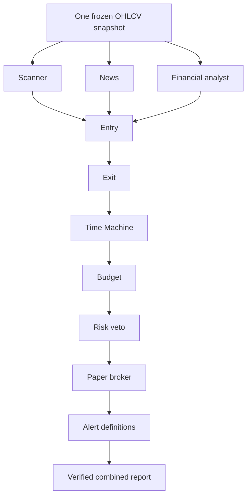

# Specialist team and upstream parity

This document describes the **sealed independent-review mode**, retained for native specialist reviews and the dashboard. The restored original-style Indian commands, configurable exits, alert state and local paper ledger are documented in [WORKFLOW.md](WORKFLOW.md). Its mutable handoffs and numerical paper-ticket status are separate from the strict final clearance described here.

The [original MIT repository](https://github.com/Jakeschincariol/day-trader-skill) provides eleven cooperating skills with file handoffs. Its plugin manifest loads skills; it does not package a native independent-subagent runtime. The early Indian migration preserved the names but reduced most roles to the same analysis command. This version restores distinct handoffs and adds actual Codex delegation through `$trader-team`.

## What runs



Each required role receives its own native agent context and writes its own judgement. Python generates numerical evidence once, checks exact hashes/cutoffs, recomputes the budget boundary and enforces vetoes. A positive model opinion cannot override missing numerical evidence. The coordinator records IDs returned by native spawn calls; these are host provenance records, not signed identity attestation. Host permissions and concurrency apply. No shell subprocess is counted as an independent AI agent.

Detailed dispatch instructions, prerequisite reviews, source rules and JSON schema are in [the workflow contract](../trader-team/references/workflow.md). Optional profiles in `codex-agents/` use the standalone TOML format described in the [official Codex subagent documentation](https://learn.chatgpt.com/docs/agent-configuration/subagents). Skills are installed with `python3 install_codex.py`; named profiles are optional and are not installed automatically. A host can spawn a generic agent and give it the role's SKILL.md. Existing global configuration is not changed.

## Handoffs

| Original role | Indian implementation | Boundary |
| --- | --- | --- |
| Scanner | Supplied-symbol opening-range scan, VWAP, RSI, EMA, volume | No automatic exchange-wide universe scan |
| News | Independent reading of exchange/issuer announcements | No automated filings adapter; unavailable evidence stays explicit |
| Entry | Completed-bar breakout and confirmation | Five-minute, long-only opening-range rule |
| Exit | Tick-rounded entry, opening-range stop, reward/risk target | Other original stop/target strategies not implemented |
| Time Machine | Historical next-bar replay and seeded whole-bar bootstrap | Minimum 20 complete prior sessions; 10,000 paths are scenarios |
| Budget | INR size, costs, cash buffer, position and daily caps | Supplied paper portfolio, no broker balance inference |
| Risk | Independent specialist veto plus numerical recheck | Bound to exact snapshot and order fingerprint |
| Broker | Draft paper ticket, reviewed before release | No execution, fills or broker transport |
| Alerts | Order-bound stop, target and flatten-time definitions | No implicit scheduling, notifications or position monitoring |
| Analyst | Independent financial filing review | No port of the US SEC extraction tool |
| Pelosi | Explicit NOT_APPLICABLE artifact | US congressional disclosure ingestion excluded |

The handoff filenames are `watchlist.json`, `news.json`, `entry.json`, `plan.json`, `timemachine.json`, `orders.json`, `state/risk.json`, `state/broker.json`, `alerts.json`, `metrics.json` and `disclosures.json`. Their schema is specific to this Indian paper workflow; original US consumers are not drop-in compatible. `context.json` seals settings, source, portfolio, limits and code hash; `snapshot.json` contains only completed observations available by the cutoff. `reviews/ROLE.json` holds independent agent decisions, and `report.json` is the combined result.

Before dispatch, `prepare` now returns and saves `preflight.json`. You can inspect a saved snapshot without changing it:

```sh
python3 trader-team/run.py preflight --session trader/team/SESSION
```

Check `should_dispatch_specialists`. Closed strategy hours, missing/stale candles, no trigger, missing/mismatched tick metadata, insufficient history or budget limits are explained before ten reviews are started. A no-trade result does not mean the scanner failed. An archive from an older engine can be diagnosed, but its original reviews cannot clear a new engine or cutoff. Do not overwrite archived reviews.

For team preparation, NSE defaults to 60 calendar days and supports 1–120 days using disjoint requests of at most 28 days each. Yahoo team requests use 60 days of five-minute history. Upstox retains its 28-day limit; select NSE or a longer authorized CSV for sufficient scenario history. Count the complete prior sessions actually returned: providers can still truncate history or fail. No gaps are filled and the 20-session minimum remains mandatory.

Pass `--security-master FILE` to team preparation, using the dated, explicit INR schema in [WORKFLOW.md](WORKFLOW.md#security-metadata). The matching record is sealed in `context.json`. A supplied `--tick` alone no longer clears numerical team risk. Missing, mismatched or synthetic metadata for a real stock prevents an order even if reviewers vote PASS. The metadata file records supplied evidence; it is not independently authenticated by the engine.

For research, an original source may have an exact timezone-aware `published_at`, or a verified `published_date` plus `publication_timezone` (IANA name). The latter uses the next local midnight as an upper bound and is accepted only once the entire publication date has ended before the cutoff and access time. This records date precision; it does not invent a publication clock. A document signing date alone does not establish its publication date. Unverifiable publication dates, same-day ambiguous timing and incomplete news coverage remain explicit limitations.

## Optional paper portfolio and limits

Pass `--portfolio PATH` to preparation. Values below are illustrative paper inputs, not fetched balances:

```json
{
  "as_of": "2026-10-19T09:35:00+05:30",
  "cash": 100000,
  "equity": 100000,
  "positions": [],
  "realized_pnl_today": 0,
  "trades_today": 0,
  "orders_today": 0
}
```

The snapshot must be no later than the analysis cutoff and at most 15 minutes old. Existing long positions require `symbol`, positive whole `qty`, `mark` and untriggered `stop < mark`. Marks/stops are user inputs, not independently reconciled market prices. Combined open risk includes estimated liquidation costs. Shorts and leverage are unsupported.

Defaults for ₹100,000 capital and ₹500 requested risk, overridable with `--team-limits PATH`:

```json
{
  "cash_buffer_fraction": 0.1,
  "max_position_fraction": 0.75,
  "max_order_value": 100000,
  "max_total_risk": 1500,
  "max_daily_loss": 1500,
  "max_trades_per_day": 3,
  "max_orders_per_day": 10,
  "min_net_rr": 1
}
```

Without explicit state, counts/P&L are assumed zero and holdings empty, labelled as a paper assumption. Files are not a persistent account ledger. Reprepare with current state before another proposal. Stops do not guarantee maximum realized loss during gaps.

## Final states

| Status | Meaning |
| --- | --- |
| PENDING_AGENT_REVIEWS | Missing or invalid reviewer identity, hash, cutoff or required evidence fields |
| BLOCKED | Numerical condition or any specialist veto blocks the plan |
| REVIEW_INCOMPLETE | All reviews collected, but required evidence unavailable or risk has not passed |
| READY_PAPER_TICKET | All required reviews valid, no veto, risk PASS and numerical checks pass |

Only READY_PAPER_TICKET exposes the combined paper ticket. Intermediate artifacts contain a draft for inspection, always with execution disabled. Every state submits zero orders. A blocked/incomplete result is a working safety decision, not a reason to invent research. The short fictional fixture should remain incomplete for full-team research; it still exercises entry, exit, costs and sizing.

This preserves the specialist cooperation requested by the user while adapting to NSE/BSE. Exact US behavior, broker integrations, profitability and availability are not claimed. Public feeds and multi-agent model access have their own limits; no lifetime-free service guarantee is possible.
